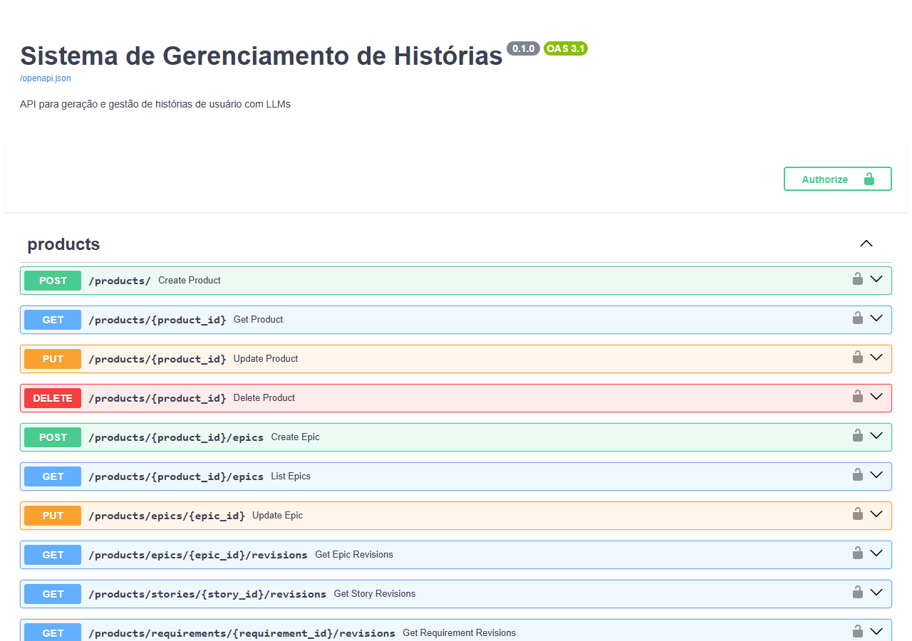
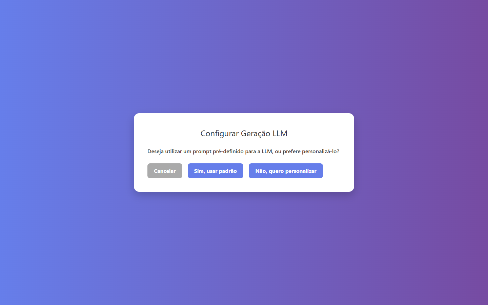

# Resolução de Problemas III

Projetos desenvolvidos em grupo no componente curricular **Resolução de Problemas III**
do curso de Engenharia de Software da **UNIPAMPA** (2025/1). Cada problema é um sistema
independente, com documentação própria na sua pasta.

| Problema | Sistema | Destaques técnicos |
| --- | --- | --- |
| [Problema 1](problema-1/) | Gestão de estoque | Python, persistência em JSON, relatório de movimentações em CSV |
| [Problema 2](problema-2/) | Dados médicos | Programação funcional em Python, autenticação com hash, métricas estatísticas, testes |
| [Problema 3](problema-3/) | Recomendação de carreiras | Regras lógicas no estilo Prolog em Python, SQLite, justificativas explicáveis |
| [Problema 4](problema-4/) | Histórias de usuário com LLMs | API FastAPI, SQLAlchemy/Alembic, programação orientada a aspectos, CLI com Typer, front em Next.js |

### Problema 4 em imagens

| API (FastAPI / Swagger) | Interface: configuração da geração por LLM |
| --- | --- |
|  |  |

## Minha contribuição

Fui autora de 146 dos 323 commits do repositório, com participação nos quatro problemas:

- **Problema 1:** módulos de estoque, produtos, movimentações de entrada e saída,
  estilização do terminal e as versões de integração do sistema.
- **Problema 2:** menu principal, autenticação, gerenciamento de contas, análise e
  visualização de métricas, testes e documentação.
- **Problema 3:** motor de regras, modelo e banco de dados de estudantes, interfaces
  do sistema e do gestor, e a integração da entrega final.
- **Problema 4:** backend da API (CRUD de produtos, autenticação, modelos e sessão de
  banco de dados), aspecto de integração com LLM e adaptação do front-end.

Também fui responsável por boa parte das integrações entre as branches do grupo.

## Sobre este repositório

Cópia, com histórico, do repositório original do grupo no GitLab da UNIPAMPA.
O trabalho final está na branch `development`; as demais branches são o trabalho
individual de cada integrante.

Para publicação, o histórico foi filtrado:

- um arquivo `.env` com credencial foi removido;
- os datasets `dataset_saude.csv` (78 MB e 120 MB) do Problema 2 foram removidos por
  excederem o limite do GitHub. O próprio sistema gera datasets sintéticos para testes;
- arquivos gerados (`node_modules` e logs de execução do Problema 4) foram removidos;
- os e-mails dos colaboradores foram anonimizados (os nomes foram mantidos).

**Equipe:** Emilly Nascimento Dias, Eric Santos de Moraes, Matheus Domingues Cabral,
Douglas Israel Siqueira da Silva e Guilherme Vicente.
