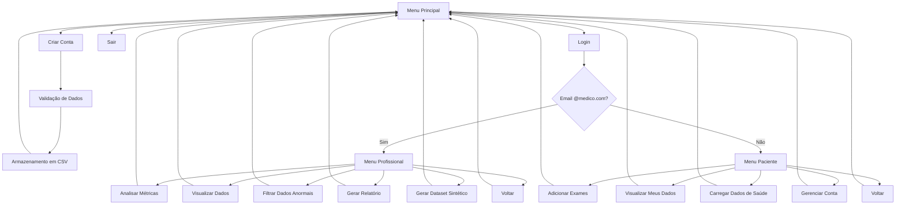

# Sistema de Dados Médicos - Problema II (2025/1)

Este projeto implementa um sistema completo para gerenciamento e análise de dados médicos utilizando **programação funcional** em Python. Desenvolvido como parte da disciplina **Resolução de Problemas III** pelo **Grupo 05**.

## Funcionalidades Principais

### Autenticação
- Cadastro seguro de usuários (pacientes e profissionais)
- Login com diferenciação automática por tipo de usuário (baseado no email)
- Armazenamento seguro de senhas (hash SHA-256)
- Validações rigorosas de dados (nome, email, senha)

### Área do Paciente
- Adicionar novos exames médicos
- Carregar dados de saúde via arquivos CSV
- Visualizar dados pessoais de saúde (limite de 10 registros)
- Acompanhar métricas pessoais

### Área Profissional (@medico.com)
- Carregar dados de pacientes
- Analisar métricas estatísticas (média, mediana, moda, desvio padrão, variância)
- Visualizar dados completos com controle de quantidade
- Filtrar dados anormais/excepcionais
- Gerar relatórios em CSV ou JSON
- Gerar datasets sintéticos para testes

### Administração
- Gerenciamento completo de contas (CRUD)
- Busca detalhada por email
- Edição segura de informações
- Exclusão de contas com confirmação

## Fluxo do Sistema



### Descrição dos Fluxos

1. **Menu Principal**:
   - Criar Conta: Novo cadastro de usuário (tipo determinado pelo email)
   - Login: Acesso ao sistema
   - Sair: Encerramento do sistema

2. **Menu Profissional**:
   - Analisar Métricas: Cálculo de estatísticas (média, mediana, moda, etc.)
   - Visualizar Dados: Visualização controlada de registros
   - Filtrar Dados Anormais: Identificação de valores fora do padrão
   - Gerar Relatório: Criação de relatórios em CSV/JSON
   - Gerar Dataset Sintético: Criação de dados para testes
   - Voltar: Retorno ao menu principal

3. **Menu Paciente**:
   - Adicionar Exames: Inclusão de novos registros médicos
   - Visualizar Meus Dados: Visualização limitada (10 registros)
   - Carregar Dados de Saúde: Importação de arquivos CSV
   - Gerenciar Conta: Visualizar, editar ou excluir conta
   - Voltar: Retorno ao menu principal

## Estrutura do Projeto

```bash
problema-2/
│
├── src/
│   ├── main.py                    # Interface principal do sistema
│   │
│   ├── autenticacao/              # Módulo de autenticação
│   │   ├── autenticacao.py        # Lógica de login e criação de conta
│   │   ├── validacoes.py          # Validações de dados
│   │   └── utilitarios.py         # Funções utilitárias (hash, normalização)
│   │
│   ├── administracao/             # Gerenciamento de contas
│   │   └── gerenciarConta.py      # CRUD de usuários
│   │
│   ├── analise/                   # Análise de dados
│   │   ├── analisar_metricas.py   # Cálculo de estatísticas
│   │   ├── carregar_dados_saude.py # Carregamento lazy de dados
│   │   ├── visualizar_dados.py    # Visualização formatada
│   │   ├── filtrar_dados.py       # Filtragem de valores anormais
│   │   ├── adicionar_exames.py    # Adição de novos registros
│   │   └── gerador_dataset_saude.py # Geração de dados sintéticos
│  
├── relatorios/                    # Geração de relatórios
│   └── relatorios.py              # Funções de geração de relatórios
│
├── dados/                         # Armazenamento de dados
│   ├── contas.csv                 # Banco de dados de usuários
│   └── pacientes/                 # Dados de pacientes
│
├── testes/                        # Testes automatizados
│   └── test_gerenciarConta.py     # Testes do módulo de contas
│
├── __init__.py                    # Inicializador do pacote
└── README.md                      # Documentação do projeto
```

## Como Executar

1. **Pré-requisitos**:
   - Python 3.10+
   - Git (opcional)

2. **Instalação**:
   ```bash
   git clone https://gitlab.unipampa.edu.br/ales/rp-iii-2025.1/grupo-05.git
   cd problema-2
   ```

3. **Execução**:
   ```bash
   python -m src.main
   ```

## Tecnologias e Paradigmas

| Categoria          | Tecnologias/Conceitos                         |
|--------------------|-----------------------------------------------|
| Linguagem          | Python 3.10+                                  |
| Paradigma          | Programação Funcional Pura                    |
| Técnicas           | Map/Reduce/Filter, Lazy Evaluation, Compose   |
| Segurança          | Hashing SHA-256, Validação Rigorosa          |
| Persistência       | Arquivos CSV                                 |
| UI                 | Terminal Colorido (ANSI)                     |

## Exemplos de Uso

1. **Como paciente**:
   ```bash
   > python -m src.main
   [1] Criar conta
   [2] Login
   > 1
   Nome: João Silva
   Email: joao@gmail.com
   Senha: Senha123
   ```

2. **Como profissional**:
   ```bash
   > python -m src.main
   [1] Criar conta
   [2] Login
   > 1
   Nome: Dr. Silva
   Email: dr.silva@medico.com
   Senha: Senha123
   ```

## Características de Programação Funcional

1. **Funções Puras**:
   - Todas as operações são realizadas por funções puras
   - Sem efeitos colaterais
   - Saídas determinadas apenas pelas entradas

2. **Imutabilidade**:
   - Dados são tratados como imutáveis
   - Novas instâncias são criadas ao invés de modificar existentes

3. **Composição de Funções**:
   - Uso extensivo de `compose` para encadear operações
   - Funções pequenas e focadas
   - Fácil combinação e reutilização

4. **Lazy Loading**:
   - Carregamento preguiçoso de dados
   - Processamento sob demanda
   - Eficiente para grandes volumes de dados

## Equipe
**Grupo 05 - RP III - UNIPAMPA**  
@author Emilly Dias
@author Eric Moraes
@author Douglas Siqueira
@author Matheus

