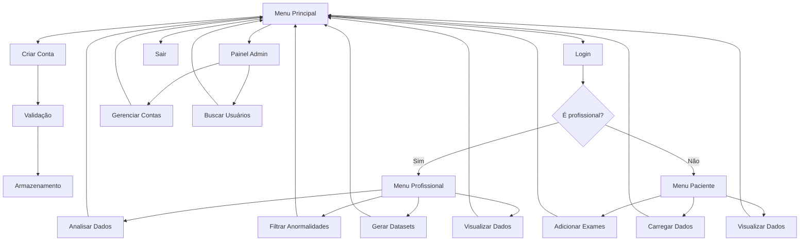

# README Atualizado para o Sistema de Dados Médicos

```markdown
# Sistema de Dados Médicos - Problema II (2025/1)

Este projeto implementa um sistema completo para gerenciamento e análise de dados médicos utilizando **programação funcional** em Python. Desenvolvido como parte da disciplina **Resolução de Problemas III** pelo **Grupo 05**.

## Funcionalidades Principais

### Autenticação
- Cadastro seguro de usuários (pacientes e profissionais)
- Login com diferenciação automática por tipo de usuário
- Armazenamento seguro de senhas (hash SHA-256)

### Área do Paciente
- Adicionar novos exames médicos
- Carregar dados de saúde via arquivos CSV
- Visualizar dados pessoais de saúde
- Acompanhar métricas pessoais

### Área Profissional (@medico.com)
- Carregar dados de pacientes
- Analisar métricas estatísticas (média, mediana, moda)
- Visualizar dados completos
- Filtrar dados anormais/excepcionais
- Gerar datasets sintéticos para testes

### Administração
- Gerenciamento completo de contas (CRUD)
- Busca detalhada por ID de usuário

## Fluxo Completo do Sistema



## Estrutura do Projeto Atualizada

```bash
problema-2/
│
├── src/
│   ├── main.py                    # Ponto de entrada do sistema
│   │
│   ├── autenticacao/              # Módulo de autenticação
│   │   ├── autenticacao.py        # Lógica de login
│   │   ├── validacoes.py          # Validações de dados
│   │   └── utilitarios.py         # Funções auxiliares (hash, normalização)
│   │
│   ├── administracao/             # Gerenciamento de contas
│   │   └── gerenciarConta.py      # CRUD de usuários
│   │
│   ├── analise/                   # Análise de dados
│   │   ├── analisar_metricas.py   # Cálculo de estatísticas
│   │   ├── carregar_dados_saude.py # Carregamento lazy
│   │   ├── visualizar_dados.py    # Visualização formatada
│   │   ├── filtrar_dados.py       # Filtragem de valores anormais
│   │   ├── adicionar_exames.py    # Adição de novos registros
│   │   └── gerar_dataset_saude.py # Geração de dados sintéticos
│  
├── relatorios/
│   ├── __init__.py
│   ├── relatorios.py               # Funções principais
│   └── exemplo_relatorio.py        # Exemplos/templates
│
├── dados/
│   ├── contas.csv                 # Banco de dados de usuários
│   ├── datasets/                  # Datasets sintéticos
│   └── pacientes/                 # Dados reais de pacientes
│
├── testes/                         # Testes automatizados
│   └── test_gerenciarConta.py
└── README.md                      # Documentação atual
```

## Como Executar

1. **Pré-requisitos**:
   - Python 3.10+
   - Git (opcional)

2. **Instalação**:
   ```bash
   git clone https://gitlab.unipampa.edu.br/ales/rp-iii-2025.1/grupo-05.git
   cd problema-2
   ```

3. **Execução**:
   ```bash
   python -m src.main
   ```

4. **Dados de Teste**:
   - Use `exemplo_batimentos.csv` na pasta `data/` para testes iniciais
   - Profissionais podem gerar datasets sintéticos pelo menu

## Tecnologias e Paradigmas

| Categoria          | Tecnologias/Conceitos                         |
|--------------------|-----------------------------------------------|
| Linguagem          | Python 3.10+                                  |
| Paradigma          | Programação Funcional Pura                    |
| Técnicas           | Map/Reduce/Filter, Lazy Evaluation           |
| Segurança          | Hashing SHA-256, Validação Rigorosa          |
| Persistência       | Arquivos CSV                                 |
| UI                 | Terminal Colorido                            |

## Exemplos de Uso

1. **Como paciente**:
   ```bash
   > python -m src.main
   [1] Criar nova conta
   [2] Login
   > 1
   Nome: João Silva
   Email: joao@gmail.com
   Senha: ********
   ```

2. **Como profissional**:
   ```bash
   Analisar métricas para batimentos.csv:
   Média: 72.5
   Mediana: 71.0
   Desvio Padrão: 4.2
   3 registros fora da faixa normal
   ```

3. **Como admin**:
   ```bash
   [Painel Admin] Buscar conta ID: 5
   Nome: Dra. Ana
   Email: ana@medico.com
   Tipo: Profissional
   ```

## Equipe
**Grupo 05 - RP III - UNIPAMPA**  
@author Emilly Dias  

